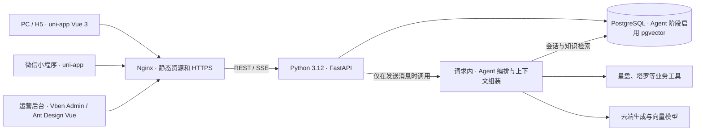

# 玄机知命 · 前后端架构与技术栈

2026-11-26 · v2.3

按现有服务器 **2 核 CPU、1.6 GB 内存、39 GB 根分区**规划。截图中内存已使用约 696 MB。部署采用单机 Docker Compose，前端在本地或 CI 构建，服务器提供静态文件、业务 API 与数据库。AI 对话从首发的塔罗师链路接入云端模型 API。

Agent 是 FastAPI 应用内的聊天功能，由发送消息的请求协程直接调用。会话 ID 用于定位 PostgreSQL 中的对话记录。

## 1. 前端架构

| 端 | 技术栈 | 架构 |
| --- | --- | --- |
| PC、H5 | uni-app Vue 3、TypeScript、Vite | 使用同一个 Web 构建。PC 展开双栏工作区，H5 使用移动布局。部署时由 Nginx 托管静态产物并转发同源 `/api` |
| 微信小程序 | uni-app Vue 3、TypeScript | 与 H5 共用页面源码、移动布局及业务逻辑，独立构建为微信小程序。真实登录和 API 请求按平台适配 |
| 运营后台 | Vue Vben Admin 的 `apps/web-antd`、Ant Design Vue | 复用开源模板的导航、页面布局和交互组件。单独静态构建并由 Nginx 托管，FastAPI 校验员工角色和接口权限 |
| 三端共用 | pnpm workspace、uni-app 路由与组件、TypeScript | `frontend/apps/client` 统一维护页面、业务状态和 Mock 数据。后端联调时按 OpenAPI 生成接口类型，接入平台请求适配 |

采用 Vite 静态构建，生产服务器只需提供构建产物。Nginx 为 Web 页面路由回退到 `index.html`，`/api` 独立转发给 FastAPI。 [Vite 静态部署](https://vite.dev/guide/static-deploy.html) · [uni-app 跨端原理](https://uniapp.dcloud.net.cn/frame.html) · [OpenAPI TypeScript](https://openapi-ts.dev/introduction)

后台业务模块见[产品规划](产品规划.md)。 [Vue Vben Admin 项目](https://github.com/vbenjs/vue-vben-admin)

## 2. 后端架构

| 层 | 主选技术 | 职责 |
| --- | --- | --- |
| API | Python 3.12、FastAPI、Pydantic v2、Uvicorn | REST、请求校验、会话鉴权、OpenAPI。Uvicorn 从单进程开始 |
| 业务 | FastAPI 模块化单体 | 按账号、八字、塔罗、星盘、内容和聊天组织。八字、抽牌、星盘规则由 Python 业务模块计算，页面和 Agent 共用这些业务接口 |
| 持久化 | PostgreSQL 17、SQLAlchemy 2.x、psycopg 3、Alembic | 存储账号、命盘、抽牌、内容和对话。异步数据库访问，按请求使用短事务和小连接池 |
| 部署 | Docker、Docker Compose、Nginx | API 和 PostgreSQL 容器化。Nginx 托管 Web、终止 HTTPS、反代 `/api`。机器已有 Nginx 时复用入口 |

Web 与小程序共用账号和权限服务。Web 使用同源会话 Cookie，小程序使用服务端签发的访问令牌。个人报告、日记和对话由业务层检查归属。轻量架构的常驻服务是 Nginx、FastAPI 和 PostgreSQL。 [FastAPI 模块组织](https://fastapi.tiangolo.com/tutorial/bigger-applications/) · [Docker Compose 部署](https://docs.docker.com/compose/how-tos/production/)

## 3. AI Agent 架构

**Pydantic AI 负责类型化工具、模型调用和结构化输出，Python 应用层控制工作流。** 占星师和占卜师共用会话存储与模型适配器，各自拥有输入要求、工具范围和检索策略。后端保存必要的会话状态，按「识别意图 → 补齐资料 → 调用工具和检索 → 生成解读 → 校验并交付」执行。资料缺失时保存待补齐的字段，用户下一轮可接着完成。依赖选用 `pydantic-ai-slim` 和实际使用的云模型组件。 [Pydantic AI 安装](https://ai.pydantic.dev/install/) · [函数工具](https://ai.pydantic.dev/tools/)

### 对话与执行

| 用户操作 | 后端行为 |
| --- | --- |
| 查看历史对话 | 按账号查询会话列表或消息记录，仅做数据库读取 |
| 开启新对话 | 按选中的占星师或占卜师创建新的 `conversation_id`，从空消息历史开始 |
| 在新对话或历史对话发消息 | 保存本条消息，读取本会话所需上下文，在当前 FastAPI 请求里 `await` Agent，将结果通过 SSE 返回并保存 |

一次发送对应一轮执行，生命周期跟随请求。请求处理、模型和检索等待以及可异步的业务工具都在同一 API 进程的异步请求链路内完成。用户停止生成或连接断开时，结束本轮并关闭上游模型流，保留已保存的消息和中断状态。重新打开会话时先读取记录，用户发送或重试时才执行下一次调用。

### 占星与占卜工作流

| Agent | 专业工作流 |
| --- | --- |
| 占星师 | 判断是通用占星问题还是个人星盘解读。需要个人星盘时，经用户确认读取已有星盘或补齐出生资料。星盘模块返回行星、宫位、相位和计算版本。Agent 按实际盘面检索对应知识，再引用盘面字段和资料来源解释 |
| 占卜师（首发以 AI 塔罗师呈现） | 确认问题和牌阵。由用户发起抽牌，业务接口用幂等键保存牌序、位置和正逆位。Agent 绑定本次抽牌 ID，检索与牌面、牌位及主题相关的资料，多轮追问沿用同一次结果 |

### 上下文工程与提示词

- **上下文组装。** 每轮从 PostgreSQL 取任务状态、经业务校验的星盘或抽牌快照、已确认的用户资料、近期消息与必要摘要。再加入本轮检索的证据。按 token 预算裁剪历史和低相关片段，保留当前问题、关键事实与待确认信息。历史摘要独立保存，星盘和抽牌事实始终从对应业务记录读取。 [Pydantic AI 对话历史](https://ai.pydantic.dev/message-history/)
- **提示词设计。** 系统约束、占星和塔罗任务模板、工具描述及少量示例独立管理版本。模板写清何时追问、怎样引用和如何表达不确定性。模型输出使用 Pydantic 定义的响应结构，包含解读、盘面或牌面依据、`source_id` 与可选追问。后端核对事实字段和引用是否来自本次工具结果及检索记录。
- **执行边界。** 工具访问绑定服务端认定的用户和资源 ID，调用前检查归属及角色权限。用户消息和检索片段作为输入数据处理。抽牌等写操作由业务接口执行并防止重复提交。为每轮设置超时、token 和工具调用次数上限，缺少可靠资料时返回追问或已有业务结果。

### RAG、评估与交付

- **RAG 知识库。** Agent 阶段在 PostgreSQL 启用 pgvector。用独立脚本将经审核的资料清洗、按概念切分，保存来源、版本、页码或章节及主题标签，调用云端 Embedding API 批量入库。查询先按领域、牌组或版本过滤，再结合向量相似度与术语别名匹配，给模型少量高相关片段。回复引用能追溯到具体片段和版本。小语料先做精确向量检索，按实测延迟再决定是否加 HNSW 索引。 [pgvector 官方文档](https://github.com/pgvector/pgvector)
- **评估与追踪。** 用 pytest 验证状态迁移、工具权限和重复请求，用 Pydantic Evals 管理固定对话样本，评估检索命中、工具选择、盘面事实与引用是否一致，以及证据不足时的追问或降级。每轮记录模型、提示词及知识库版本、工具耗时和 token 用量，支持重放和回归对比。评估在开发环境或 CI 运行。 [Pydantic Evals](https://ai.pydantic.dev/evals/)
- **前端交付。** PC、H5 用 `fetch` 发送消息，通过同一 HTTP 请求读取 SSE。先显示追问或执行进度，再展示完成事实与引用校验的解读。小程序由同一消息页面调用平台请求适配层，正式接入时验证增量消息与停止生成。Nginx 对 Web SSE 关闭响应缓冲。 [FastAPI SSE](https://fastapi.tiangolo.com/tutorial/server-sent-events/)

## 4. 单机资源与扩展边界

- **单机部署**常驻 Nginx、API 与 PostgreSQL。Agent 和在线检索跟随 API 运行，向量随同一个数据库保存，生成与向量化调用云端 API。限制数据库连接数、日志体积和同时生成的对话数量，等待模型时释放数据库连接。
- **按需扩展**出现多进程共享缓存或限流需求时再接 Redis。
